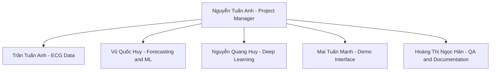

# ECG Project WBS and Resource Plan

**Revised:** 13 Nov 2026. **Baseline period:** 27 working days, 01 Oct–06 Nov 2026. Dates and hours are planned allocations, not a record of actual work performed on earlier artifacts.

## 1. Project approach and scope

The project is an academic analysis and learning demo using existing MIT-BIH ECG recordings. Deliverables include a traceable ECG analysis process, forecasting and classification results, a static website, and recorded-data replay. Results in the earlier ST-MEM research PDF and the later rerun are reported separately. The demo does not process live patient ECG, provide medical alerts, expose a production API, or claim to be a medical device.

The team uses an overall milestone plan with incremental work inside each technical branch. Data and label rules are agreed before experiments. Forecasting, ML/CNN, and ST-MEM work can overlap; the team reconciles results before placing them in the demo and completes an independent test before handover.

**Decomposition rule:** each leaf package produces one checkable deliverable. Meetings, internal approvals, and status updates are included in the relevant package's hours. Results are counted once in the model package; the final report reuses that evidence without adding duplicate experiment work.

## 2. Team structure and responsibilities

| Member (role) | Main work | Authority and handover |
|---|---|---|
| Nguyễn Tuấn Anh (PM) | Business case, charter, plan, change control, reporting, and internal acceptance. | Integrates decisions and approves assigned changes; does not perform specialist work on behalf of all members. |
| Trần Tuấn Anh (DATA) | MIT-BIH checks, EDA, signal and label rules, and data reconciliation. | Hands data and specifications to model and demo members. |
| Vũ Quốc Huy (ML) | HR series, ARIMA/SARIMA, feature models, and sourced comparison. | Confirms metric methods and sources; hands over results. |
| Nguyễn Quang Huy (DL) | CNN and ST-MEM, training configuration, weights, and limitations. | Hands over models and results; supports replay integration. |
| Mai Tuấn Mạnh (WEB) | Demo data, two website pages, and replay controls. | Hands over the demo and display-to-source mapping. |
| Hoàng Thị Ngọc Hân (QA) | Test criteria, independent verification, defect log, and user guide. | Records test results; the PM makes the acceptance decision. |

The six members each have one primary role. The baseline plan has no external hire. Capacity gaps or absence are handled through qualified backup support and an approved schedule adjustment.

## 3. WBS and package schedule

**Work** means total member labor hours; **duration** means working days between package start and finish. The project spans 27 working days from 01 Oct to 06 Nov 2026. Specialist packages can overlap, and a package can occupy several days while using only part of each day.

| WBS | Deliverable package | Workdays | Start–finish | Duration (workdays) | Work (hours) | Accountable member | FS predecessors | Acceptance evidence |
|---|---|---:|---|---:|---:|---|---|---|
| **1.0** | **Initiation and planning** | **1–3** | **01 Oct–05 Oct** | **3** | **24** | — | — | Summary of child packages |
| 1.1 | Project proposal and charter | 1–2 | 01 Oct–02 Oct | 2 | 6 | Nguyễn Tuấn Anh | — | Business case, measurable objectives, charter, and scope boundaries |
| 1.2 | Integrated project plan | 1–2 | 01 Oct–02 Oct | 2 | 8 | Nguyễn Tuấn Anh | — | WBS, schedule, cost estimate, team structure, RACI, communication, and risks |
| 1.3 | Change control and acceptance criteria | 3 | 05 Oct | 1 | 10 | Nguyễn Tuấn Anh | 1.1 | Change rules, quality criteria, and decision log; M1 plan review and approval are included in this package's work |
| **2.0** | **ECG data foundation** | **4–9** | **06 Oct–13 Oct** | **6** | **34** | — | — | Summary of child packages |
| 2.1 | ECG data inventory and exploration | 4–6 | 06 Oct–08 Oct | 3 | 14 | Trần Tuấn Anh | 1.3 | MIT-BIH record, lead, and label inventory; ECG/HR/RR/HRV plots |
| 2.2 | Preprocessed dataset and window specification | 7–9 | 09 Oct–13 Oct | 3 | 20 | Trần Tuấn Anh | 2.1 | Filtering and normalization pipeline, label rules, and dataset split; M2 data readiness review is included in this package's work |
| **3.0** | **Analysis and models** | **10–20** | **14 Oct–28 Oct** | **11** | **68** | — | — | Summary of child packages |
| 3.1 | ARIMA/SARIMA forecasting results | 10–13 | 14 Oct–19 Oct | 4 | 16 | Vũ Quốc Huy | 2.2 | Configuration, HR forecasts, MAE/RMSE, and limitations |
| 3.2 | ML and CNN classification results | 10–13 | 14 Oct–19 Oct | 4 | 24 | Vũ Quốc Huy | 2.2 | Features, models, labels, splits, and metrics for each experiment |
| 3.3 | ST-MEM results | 14–18 | 20 Oct–26 Oct | 5 | 20 | Nguyễn Quang Huy | 2.2 | Fine-tuning configuration, weights, saved results, and rerun conditions |
| 3.4 | Model comparison and limitations | 19–20 | 27 Oct–28 Oct | 2 | 8 | Vũ Quốc Huy | 3.1, 3.2, 3.3 | Metric-to-source comparison; results from different labels or splits are kept separate; M3 model review is included in this package's work |
| **4.0** | **Presentation demo** | **14–22** | **20 Oct–30 Oct** | **9** | **56** | — | — | Summary of child packages |
| 4.1 | Demo dataset and source map | 14–15 | 20 Oct–21 Oct | 2 | 14 | Mai Tuấn Mạnh | 3.2 | Static demo data, local assets, and metric-to-source map |
| 4.2 | Analysis dashboard | 16–19 | 22 Oct–27 Oct | 4 | 18 | Mai Tuấn Mạnh | 4.1 | Website sections for ECG, forecasting, and classification |
| 4.3 | Recorded ECG replay page | 19–22 | 27 Oct–30 Oct | 4 | 18 | Mai Tuấn Mạnh | 4.1, 3.3 | Nine-second replay, past-only HR/RR, rule flags, and ST-MEM after each completed window; M4 demo readiness review is shared with 4.4 |
| 4.4 | Demo user and reproduction guide | 20–21 | 28 Oct–29 Oct | 2 | 6 | Hoàng Thị Ngọc Hân | 4.2 | README, offline use conditions, data, and usage limits; M4 demo readiness review is shared with 4.3 |
| **5.0** | **Verification, report, and handover** | **21–27** | **29 Oct–06 Nov** | **7** | **58** | — | — | Summary of child packages |
| 5.1 | Test and results reconciliation record | 23–25 | 02 Nov–04 Nov | 3 | 20 | Hoàng Thị Ngọc Hân | 4.3, 4.4, 3.4 | Offline and replay test records, metric reconciliation, defects, and retest results |
| 5.2 | Complete project report | 21–24 | 29 Oct–03 Nov | 4 | 30 | Nguyễn Tuấn Anh | 3.4, 4.2 | Initiation, plan, design, results, evaluation, and appendix |
| 5.3 | Handover package and acceptance decision | 26–27 | 05 Nov–06 Nov | 2 | 8 | Nguyễn Tuấn Anh | 5.1, 5.2 | Release files, file inventory, verification results, and handover record; M5 internal acceptance is included in this package's work |

**Project duration: 27 working days; total planned work: 240 hours.** Phase durations are not added because data, model, demo, and reporting phases overlap. Gates M1–M5 are included in packages with positive work, so there are no zero-hour review tasks.

| Review gate | Workday | Planned date | Package | Exit condition |
|---|---:|---|---|---|
| M1 | 3 | 05 Oct | 1.3 | Scope, WBS, resources, and acceptance criteria agreed |
| M2 | 9 | 13 Oct | 2.2 | Data, labels, and split ready for experiments |
| M3 | 20 | 28 Oct | 3.4 | All model results have clear configuration, source, and limits |
| M4 | 22 | 30 Oct | 4.3–4.4 | Both demo pages and guide ready for QA |
| M5 | 27 | 06 Nov | 5.3 | Test record, report, and handover package accepted internally |

## 4. Responsibility assignment and labor allocation

Each package has one accountable owner (A). Members with planned work on it are responsible for execution (R); consultation (C) and information (I) are shown in the RACI matrix. All hours below are planned allocations, not actual timesheets.

| WBS | Deliverable | Nguyễn Tuấn Anh | Trần Tuấn Anh | Vũ Quốc Huy | Nguyễn Quang Huy | Mai Tuấn Mạnh | Hoàng Thị Ngọc Hân | Total |
|---|---|---:|---:|---:|---:|---:|---:|---:|
| 1.1 | Project proposal and charter | 6 | — | — | — | — | — | **6** |
| 1.2 | Integrated project plan | 4 | — | — | — | — | 4 | **8** |
| 1.3 | Change control and acceptance criteria | 8 | — | — | — | — | 2 | **10** |
| 2.1 | ECG data inventory and exploration | — | 12 | — | — | — | 2 | **14** |
| 2.2 | Preprocessed dataset and window specification | — | 8 | — | — | — | 12 | **20** |
| 3.1 | ARIMA/SARIMA forecasting results | — | 2 | 14 | — | — | — | **16** |
| 3.2 | ML and CNN classification results | — | — | 12 | 12 | — | — | **24** |
| 3.3 | ST-MEM results | — | — | — | 20 | — | — | **20** |
| 3.4 | Model comparison and limitations | — | 2 | 4 | 2 | — | — | **8** |
| 4.1 | Demo dataset and source map | — | 2 | — | — | 8 | 4 | **14** |
| 4.2 | Analysis dashboard | — | — | — | — | 18 | — | **18** |
| 4.3 | Recorded ECG replay page | — | — | — | 4 | 14 | — | **18** |
| 4.4 | Demo user and reproduction guide | — | — | — | — | — | 6 | **6** |
| 5.1 | Test and results reconciliation record | 4 | 6 | 2 | 2 | — | 6 | **20** |
| 5.2 | Complete project report | 10 | 8 | 8 | — | — | 4 | **30** |
| 5.3 | Handover package and acceptance decision | 8 | — | — | — | — | — | **8** |
| **Total** |  | **40** | **40** | **40** | **40** | **40** | **40** | **240** |

Each member has 40 planned hours in the 27-day schedule. When package work is spread evenly across its duration, peak load is eight hours in a day for Nguyễn Tuấn Anh on workday 3 and Mai Tuấn Mạnh on day 19. Neither exceeds the eight-hour daily planning capacity.

**Members with active work by calendar period:**

| Period | Workdays | Active members | Count | Chart |
|---|---:|---|---:|---|
| 01–02 Oct | 1–2 | Nguyễn Tuấn Anh, Hoàng Thị Ngọc Hân | 2 | ██ |
| 05–09 Oct | 3–7 | Nguyễn Tuấn Anh, Trần Tuấn Anh, Hoàng Thị Ngọc Hân | 3 | ███ |
| 12–16 Oct | 8–12 | Trần Tuấn Anh, Vũ Quốc Huy, Nguyễn Quang Huy, Hoàng Thị Ngọc Hân | 4 | ████ |
| 19–23 Oct | 13–17 | Trần Tuấn Anh, Vũ Quốc Huy, Nguyễn Quang Huy, Mai Tuấn Mạnh, Hoàng Thị Ngọc Hân | 5 | █████ |
| 26–30 Oct | 18–22 | Nguyễn Tuấn Anh, Trần Tuấn Anh, Vũ Quốc Huy, Nguyễn Quang Huy, Mai Tuấn Mạnh, Hoàng Thị Ngọc Hân | 6 | ██████ |
| 02–06 Nov | 23–27 | Nguyễn Tuấn Anh, Trần Tuấn Anh, Vũ Quốc Huy, Nguyễn Quang Huy, Hoàng Thị Ngọc Hân | 5 | █████ |

## 5. General RACI matrix

| Phase / work package | Nguyễn Tuấn Anh | Trần Tuấn Anh | Vũ Quốc Huy | Nguyễn Quang Huy | Mai Tuấn Mạnh | Hoàng Thị Ngọc Hân |
|---|---|---|---|---|---|---|
| **1.0 Initiation and planning** |   |   |   |   |   |   |
| 1.1 Project proposal and charter | A/R | C | I | I | I | C |
| 1.2 Integrated project plan | A/R | C | C | C | C | R |
| 1.3 Change control and acceptance criteria | A/R | C | C | C | C | R |
| **2.0 ECG data foundation** |   |   |   |   |   |   |
| 2.1 ECG data inventory and exploration | I | A/R | C | I | I | R |
| 2.2 Preprocessed dataset and window specification | I | A/R | C | C | I | R |
| **3.0 Analysis and models** |   |   |   |   |   |   |
| 3.1 ARIMA/SARIMA forecasting results | I | R | A/R | C | I | C |
| 3.2 ML and CNN classification results | I | C | A/R | R | I | C |
| 3.3 ST-MEM results | I | C | C | A/R | C | I |
| 3.4 Model comparison and limitations | I | R | A/R | R | C | C |
| **4.0 Presentation demo** |   |   |   |   |   |   |
| 4.1 Demo dataset and source map | I | R | C | C | A/R | R |
| 4.2 Analysis dashboard | I | C | C | C | A/R | C |
| 4.3 Recorded ECG replay page | I | C | C | R | A/R | C |
| 4.4 Demo user and reproduction guide | I | C | I | C | C | A/R |
| **5.0 Verification, report, and handover** |   |   |   |   |   |   |
| 5.1 Test and results reconciliation record | R | R | R | R | C | A/R |
| 5.2 Complete project report | A/R | R | R | C | C | R |
| 5.3 Handover package and acceptance decision | A/R | I | I | I | C | C |

**R:** responsible for execution; **A:** accountable for the final outcome; **C:** consulted; **I:** informed. **A/R:** the same person executes and owns the result. The matrix has only the six internal members; the instructor or reviewer receives the deliverable through the course process and is not a team RACI column.

## 6. Logic and control checks

1. Package 2.2 fixes labels, windows, and splits before model comparison. CNN, feature-model, and ST-MEM results with different experiment conditions are reported separately.
2. Package 4.1 uses available data and results. Package 4.3 reveals ST-MEM only after a completed nine-second window. The demo replays recorded data; it is not a live medical monitoring system.
3. Hoàng Thị Ngọc Hân leads package 5.1 and records independent checks, while model owners reconcile their numbers. Nguyễn Tuấn Anh makes the internal acceptance decision for 5.3 after reviewing the test record.
4. Changes affecting scope, the 27-workday baseline, or cost require a recorded reason, impact, and decision before the baseline is revised. Planned hours are not entered as actual hours.
5. Planning cost: 240 hours × VND 50,000/hour = **VND 12,000,000**; 10% contingency = **VND 1,200,000**; total planning estimate = **VND 13,200,000**. This is a course labor-cost estimate, not cash already spent.
