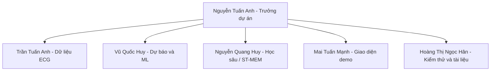

# WBS và kế hoạch nguồn lực dự án ECG

**Bản kế hoạch điều chỉnh:** 12/11/2026. **Kỳ kế hoạch tham chiếu:** 27 ngày làm việc, 01/10–06/11/2026. Đây là lịch và giờ công **dự kiến để lập kế hoạch**, không phải nhật ký thực tế của các tệp đã được tạo trước đó.

## 1. Hướng thực hiện và ranh giới

Dự án hướng tới **nghiên cứu và trình diễn giáo dục trên dữ liệu MIT-BIH có sẵn**. Sản phẩm gồm quy trình phân tích ECG, kết quả dự báo/phân loại có thể truy nguồn, website tĩnh và màn hình phát lại bản ghi. Kết quả ST-MEM trong báo cáo nghiên cứu và kết quả chạy lại được ghi tách biệt. Dự án không xử lý ECG bệnh nhân trực tiếp, không phát cảnh báo y tế, không triển khai API sản xuất và không tự nhận là thiết bị y tế.

Cách tổ chức phù hợp là **lập mốc tổng thể và thực hiện tăng dần**: chốt dữ liệu/quy tắc nhãn trước thí nghiệm; các nhánh dự báo, ML/CNN và ST-MEM chạy song song; đối chiếu số liệu trước khi đưa lên demo; kiểm thử độc lập trước bàn giao. Việc lặp trong từng nhánh kỹ thuật không làm thay đổi phạm vi nếu không qua kiểm soát thay đổi.

**Nguyên tắc phân rã:** mỗi gói dưới đây tạo một đầu ra kiểm tra được. Họp, duyệt nội bộ và cập nhật trạng thái là hoạt động nằm trong giờ công của gói liên quan; không lập thành task riêng. Một bảng kết quả chỉ được tính một lần ở gói mô hình; gói báo cáo dùng lại bằng chứng đó, không chạy lại cùng thí nghiệm để tính thêm giờ.

## 2. Cơ cấu nhóm và vai trò

| Thành viên (vai trò) | Đầu việc chính | Quyền và điểm bàn giao |
|---|---|---|
| Nguyễn Tuấn Anh (PM) | Business case, charter, kế hoạch, kiểm soát thay đổi, báo cáo và nghiệm thu nội bộ | Duyệt thay đổi trong phạm vi được giao; tổng hợp quyết định, không làm thay phần kỹ thuật |
| Trần Tuấn Anh (DATA) | Kiểm tra dữ liệu MIT-BIH, EDA, quy tắc tín hiệu/nhãn, đối chiếu dữ liệu | Bàn giao dữ liệu và đặc tả cho nhóm mô hình/demo |
| Vũ Quốc Huy (ML) | HR series, ARIMA/SARIMA, mô hình đặc trưng và bảng so sánh | Chốt phép đo/nguồn chỉ số; bàn giao bảng kết quả |
| Nguyễn Quang Huy (DL) | CNN và ST-MEM, cấu hình huấn luyện, trọng số và giới hạn | Bàn giao mô hình/kết quả, hỗ trợ tích hợp replay |
| Mai Tuấn Mạnh (WEB) | Dữ liệu trình diễn, hai trang web, điều khiển replay | Bàn giao bản demo và mapping hiển thị |
| Hoàng Thị Ngọc Hân (QA) | Tiêu chí kiểm thử, kiểm tra độc lập, tài liệu hướng dẫn | Ghi lỗi và kết quả kiểm thử; không tự phê duyệt thay PM |

Nhóm gồm sáu thành viên, mỗi người phụ trách một vai trò chính. Không tuyển ngoài trong kế hoạch cơ sở; khi thiếu năng lực hoặc vắng mặt, PM tổ chức hỗ trợ chéo và trình duyệt điều chỉnh lịch.

## 3. WBS và lịch gói công việc

**Effort** là giờ làm của cả nhóm; **duration** là ngày làm việc từ Start đến Finish. Lịch tập trung trong **27 ngày làm việc (01/10–06/11/2026)**. Các công việc khác chuyên môn có thể làm song song; một gói 2 ngày có thể có ít giờ công vì người phụ trách chỉ dành một phần ngày cho dự án.

| WBS | Gói bàn giao | Ngày LV | Ngày bắt đầu–kết thúc | Duration (ngày LV) | Effort (giờ) | A / trưởng gói | Phụ thuộc FS | Bằng chứng hoàn thành |
|---|---|---:|---|---:|---:|---|---|---|
| **1.0** | **Khởi tạo và lập kế hoạch** | **1–3** | **01/10–05/10** | **3** | **24** | — | — | Tổng hợp các gói con |
| 1.1 | Hồ sơ đề xuất và điều lệ dự án | 1–2 | 01/10–02/10 | 2 | 6 | Nguyễn Tuấn Anh | — | Business case, mục tiêu đo được, charter và ranh giới phạm vi |
| 1.2 | Kế hoạch tổng hợp | 1–2 | 01/10–02/10 | 2 | 8 | Nguyễn Tuấn Anh | — | WBS, lịch, dự toán, cơ cấu nhóm, RACI, truyền thông và rủi ro |
| 1.3 | Quy trình kiểm soát và tiêu chí nghiệm thu | 3 | 05/10 | 1 | 10 | Nguyễn Tuấn Anh | 1.1 | Quy tắc thay đổi, tiêu chí chất lượng, cách ghi quyết định; M1: rà soát và phê duyệt kế hoạch trong giờ công của gói 1.3. |
| **2.0** | **Nền tảng dữ liệu ECG** | **4–9** | **06/10–13/10** | **6** | **34** | — | — | Tổng hợp các gói con |
| 2.1 | Hồ sơ dữ liệu và khám phá ECG | 4–6 | 06/10–08/10 | 3 | 14 | Trần Tuấn Anh | 1.3 | Danh mục MIT-BIH, lead, nhãn, biểu đồ ECG/HR/RR/HRV |
| 2.2 | Bộ dữ liệu tiền xử lý và đặc tả cửa sổ | 7–9 | 09/10–13/10 | 3 | 20 | Trần Tuấn Anh | 2.1 | Pipeline lọc/chuẩn hóa, quy tắc nhãn và chia tập; M2: xác nhận dữ liệu, nhãn và split sẵn sàng trong giờ công của gói 2.2. |
| **3.0** | **Phân tích và mô hình** | **10–20** | **14/10–28/10** | **11** | **68** | — | — | Tổng hợp các gói con |
| 3.1 | Kết quả dự báo ARIMA/SARIMA | 10–13 | 14/10–19/10 | 4 | 16 | Vũ Quốc Huy | 2.2 | Cấu hình, dự báo HR, MAE/RMSE và giới hạn |
| 3.2 | Kết quả phân loại ML và CNN | 10–13 | 14/10–19/10 | 4 | 24 | Vũ Quốc Huy | 2.2 | Đặc trưng, mô hình, nhãn, split và chỉ số theo từng thí nghiệm |
| 3.3 | Kết quả ST-MEM | 14–18 | 20/10–26/10 | 5 | 20 | Nguyễn Quang Huy | 2.2 | Cấu hình fine-tune, trọng số, kết quả lưu và điều kiện tái chạy |
| 3.4 | Bảng đối chiếu mô hình và giới hạn | 19–20 | 27/10–28/10 | 2 | 8 | Vũ Quốc Huy | 3.1; 3.2; 3.3 | Bảng nguồn số liệu; không so trực tiếp thí nghiệm khác nhãn/split; M3: đối chiếu và chốt kết quả mô hình trong giờ công của gói 3.4. |
| **4.0** | **Demo trình diễn** | **14–22** | **20/10–30/10** | **9** | **56** | — | — | Tổng hợp các gói con |
| 4.1 | Dữ liệu trình diễn và bản đồ nguồn | 14–15 | 20/10–21/10 | 2 | 14 | Mai Tuấn Mạnh | 3.2 | Dữ liệu tĩnh, tài nguyên cục bộ và mapping metric đến nguồn |
| 4.2 | Trang tổng quan phân tích | 16–19 | 22/10–27/10 | 4 | 18 | Mai Tuấn Mạnh | 4.1 | Trang web với các mục ECG, dự báo và phân loại |
| 4.3 | Trang phát lại ECG đã ghi | 19–22 | 27/10–30/10 | 4 | 18 | Mai Tuấn Mạnh | 4.1; 3.3 | Replay 9 giây, HR/RR quá khứ, cờ quy tắc và ST-MEM sau cửa sổ; M4: cùng gói 4.4 xác nhận demo sẵn sàng kiểm thử. |
| 4.4 | Hướng dẫn sử dụng và tái tạo demo | 20–21 | 28/10–29/10 | 2 | 6 | Hoàng Thị Ngọc Hân | 4.2 | README, điều kiện offline, dữ liệu và giới hạn sử dụng; M4: cùng gói 4.3 xác nhận demo sẵn sàng kiểm thử. |
| **5.0** | **Kiểm chứng, báo cáo và bàn giao** | **21–27** | **29/10–06/11** | **7** | **58** | — | — | Tổng hợp các gói con |
| 5.1 | Hồ sơ kiểm thử và đối chiếu kết quả | 23–25 | 02/11–04/11 | 3 | 20 | Hoàng Thị Ngọc Hân | 4.3; 4.4; 3.4 | Biên bản thử offline/replay, đối chiếu metric, lỗi và kết quả sửa |
| 5.2 | Báo cáo dự án hoàn chỉnh | 21–24 | 29/10–03/11 | 4 | 30 | Nguyễn Tuấn Anh | 3.4; 4.2 | Khởi tạo, kế hoạch, thiết kế, kết quả, đánh giá và phụ lục |
| 5.3 | Gói bàn giao và quyết định nghiệm thu | 26–27 | 05/11–06/11 | 2 | 8 | Nguyễn Tuấn Anh | 5.1; 5.2 | Bản phát hành, danh mục tệp, kết quả kiểm tra và biên bản bàn giao; M5: nghiệm thu nội bộ và bàn giao trong giờ công của gói 5.3. |

**Tổng thời gian: 27 ngày làm việc; tổng effort: 240 giờ.** Duration của 5 nhóm WBS không cộng lại vì các nhóm dữ liệu/kế hoạch, mô hình/demo và demo/báo cáo chồng thời gian. M1–M5 vẫn là điểm kiểm tra trong gói có giờ công, không có task 0 giờ.

| Điểm kiểm tra | Ngày LV | Ngày dự kiến | Gói thực hiện | Điều kiện quyết định |
|---|---:|---|---|---|
| M1 | 3 | 05/10 | 1.3 | Phạm vi, WBS, nguồn lực và tiêu chí nghiệm thu được thống nhất |
| M2 | 9 | 13/10 | 2.2 | Dữ liệu, nhãn và chia tập đủ điều kiện chạy thí nghiệm |
| M3 | 20 | 28/10 | 3.4 | Kết quả ba nhánh có cấu hình, nguồn và giới hạn rõ ràng |
| M4 | 22 | 30/10 | 4.3–4.4 | Hai trang demo và hướng dẫn sẵn sàng cho QA |
| M5 | 27 | 06/11 | 5.3 | Hồ sơ kiểm thử, báo cáo và gói bàn giao được chấp nhận nội bộ |

## 4. Bảng phân nhiệm và phân bổ giờ

Mỗi hàng có **một A** chịu trách nhiệm cuối cho đầu ra, các vai trò có giờ công là **R** tham gia thực hiện; C được hỏi trước quyết định, I được thông báo. Số giờ là dự kiến theo vai trò, không phải chấm công thực tế.

| WBS | Đầu ra | Nguyễn Tuấn Anh | Trần Tuấn Anh | Vũ Quốc Huy | Nguyễn Quang Huy | Mai Tuấn Mạnh | Hoàng Thị Ngọc Hân | Tổng |
|---|---|---:|---:|---:|---:|---:|---:|
| 1.1 | Hồ sơ đề xuất và điều lệ dự án | 6 | — | — | — | — | — | **6** |
| 1.2 | Kế hoạch tổng hợp | 4 | — | — | — | — | 4 | **8** |
| 1.3 | Quy trình kiểm soát và tiêu chí nghiệm thu | 8 | — | — | — | — | 2 | **10** |
| 2.1 | Hồ sơ dữ liệu và khám phá ECG | — | 12 | — | — | — | 2 | **14** |
| 2.2 | Bộ dữ liệu tiền xử lý và đặc tả cửa sổ | — | 8 | — | — | — | 12 | **20** |
| 3.1 | Kết quả dự báo ARIMA/SARIMA | — | 2 | 14 | — | — | — | **16** |
| 3.2 | Kết quả phân loại ML và CNN | — | — | 12 | 12 | — | — | **24** |
| 3.3 | Kết quả ST-MEM | — | — | — | 20 | — | — | **20** |
| 3.4 | Bảng đối chiếu mô hình và giới hạn | — | 2 | 4 | 2 | — | — | **8** |
| 4.1 | Dữ liệu trình diễn và bản đồ nguồn | — | 2 | — | — | 8 | 4 | **14** |
| 4.2 | Trang tổng quan phân tích | — | — | — | — | 18 | — | **18** |
| 4.3 | Trang phát lại ECG đã ghi | — | — | — | 4 | 14 | — | **18** |
| 4.4 | Hướng dẫn sử dụng và tái tạo demo | — | — | — | — | — | 6 | **6** |
| 5.1 | Hồ sơ kiểm thử và đối chiếu kết quả | 4 | 6 | 2 | 2 | — | 6 | **20** |
| 5.2 | Báo cáo dự án hoàn chỉnh | 10 | 8 | 8 | — | — | 4 | **30** |
| 5.3 | Gói bàn giao và quyết định nghiệm thu | 8 | — | — | — | — | — | **8** |
| **Tổng** |  | **40** | **40** | **40** | **40** | **40** | **40** | **240** |

Tổng 40 giờ/người trong 27 ngày làm việc, bình quân khoảng **1,48 giờ/ngày/người**. Khi chia effort đều trong duration của từng gói, tải lớn nhất là **8 giờ/ngày** ở Nguyễn Tuấn Anh (ngày 3) và Mai Tuấn Mạnh (ngày 19), bằng công suất 8 giờ/ngày, không vượt tải. Đây là kiểm tra công suất kế hoạch, không phải giờ thực tế.

**Biểu đồ thành viên có việc theo tuần lịch** (số thành viên có gói đang mở):

| Kỳ | Ngày LV | Thành viên có công việc | Số thành viên | Biểu đồ |
|---|---:|---|---:|---|
| 01–02/10 | 1–2 | Nguyễn Tuấn Anh, Hoàng Thị Ngọc Hân | 2 | ██ |
| 05–09/10 | 3–7 | Nguyễn Tuấn Anh, Trần Tuấn Anh, Hoàng Thị Ngọc Hân | 3 | ███ |
| 12–16/10 | 8–12 | Trần Tuấn Anh, Vũ Quốc Huy, Nguyễn Quang Huy, Hoàng Thị Ngọc Hân | 4 | ████ |
| 19–23/10 | 13–17 | Trần Tuấn Anh, Vũ Quốc Huy, Nguyễn Quang Huy, Mai Tuấn Mạnh, Hoàng Thị Ngọc Hân | 5 | █████ |
| 26–30/10 | 18–22 | Nguyễn Tuấn Anh, Trần Tuấn Anh, Vũ Quốc Huy, Nguyễn Quang Huy, Mai Tuấn Mạnh, Hoàng Thị Ngọc Hân | 6 | ██████ |
| 02–06/11 | 23–27 | Nguyễn Tuấn Anh, Trần Tuấn Anh, Vũ Quốc Huy, Nguyễn Quang Huy, Hoàng Thị Ngọc Hân | 5 | █████ |

## 5. Ma trận RACI tổng quát

| Nhóm / gói công việc | Nguyễn Tuấn Anh | Trần Tuấn Anh | Vũ Quốc Huy | Nguyễn Quang Huy | Mai Tuấn Mạnh | Hoàng Thị Ngọc Hân |
|---|---|---|---|---|---|---|
| **1.0 Khởi tạo và lập kế hoạch** |  |  |  |  |  |  |
| 1.1 Hồ sơ đề xuất và điều lệ dự án | A/R | C | I | I | I | C |
| 1.2 Kế hoạch tổng hợp | A/R | C | C | C | C | R |
| 1.3 Quy trình kiểm soát và tiêu chí nghiệm thu | A/R | C | C | C | C | R |
| **2.0 Nền tảng dữ liệu ECG** |  |  |  |  |  |  |
| 2.1 Hồ sơ dữ liệu và khám phá ECG | I | A/R | C | I | I | R |
| 2.2 Bộ dữ liệu tiền xử lý và đặc tả cửa sổ | I | A/R | C | C | I | R |
| **3.0 Phân tích và mô hình** |  |  |  |  |  |  |
| 3.1 Kết quả dự báo ARIMA/SARIMA | I | R | A/R | C | I | C |
| 3.2 Kết quả phân loại ML và CNN | I | C | A/R | R | I | C |
| 3.3 Kết quả ST-MEM | I | C | C | A/R | C | I |
| 3.4 Bảng đối chiếu mô hình và giới hạn | I | R | A/R | R | C | C |
| **4.0 Demo trình diễn** |  |  |  |  |  |  |
| 4.1 Dữ liệu trình diễn và bản đồ nguồn | I | R | C | C | A/R | R |
| 4.2 Trang tổng quan phân tích | I | C | C | C | A/R | C |
| 4.3 Trang phát lại ECG đã ghi | I | C | C | R | A/R | C |
| 4.4 Hướng dẫn sử dụng và tái tạo demo | I | C | I | C | C | A/R |
| **5.0 Kiểm chứng, báo cáo và bàn giao** |  |  |  |  |  |  |
| 5.1 Hồ sơ kiểm thử và đối chiếu kết quả | R | R | R | R | C | A/R |
| 5.2 Báo cáo dự án hoàn chỉnh | A/R | R | R | C | C | R |
| 5.3 Gói bàn giao và quyết định nghiệm thu | A/R | I | I | I | C | C |

**R:** thực hiện; **A:** chịu trách nhiệm cuối; **C:** được tham vấn; **I:** được thông báo. **A/R:** vừa phụ trách vừa làm. Ma trận chỉ có sáu thành viên nội bộ; người chấm/giảng viên nhận sản phẩm theo quy trình học phần, không được gán một cột RACI của nhóm.

## 6. Điều kiện kiểm soát logic

1. Nhãn/cửa sổ và split của 2.2 phải cố định trước khi so mô hình. Kết quả CNN, mô hình đặc trưng và ST-MEM có điều kiện thí nghiệm khác nhau thì công bố riêng.
2. 4.1 dùng dữ liệu/kết quả đã có; 4.3 chỉ hiển thị ST-MEM khi cửa sổ 9 giây kết thúc. Demo là phát lại dữ liệu ghi sẵn, không phải hệ thống giám sát y tế trực tiếp.
3. 5.1 do QA dẫn dắt, có chủ mô hình đối chiếu số liệu nhưng QA tự ghi kết quả kiểm tra; 5.3 do PM đưa quyết định nghiệm thu nội bộ sau khi xem biên bản.
4. Mọi thay đổi ảnh hưởng phạm vi, lịch 27 ngày làm việc hoặc ngân sách phải ghi nguyên nhân, tác động và quyết định trước khi sửa baseline. Không ghi giờ kế hoạch thành giờ thực tế.
5. Chi phí tham chiếu: 240 giờ × 50.000 đồng/giờ = **12.000.000 đồng**; dự phòng kế hoạch 10% = **1.200.000 đồng**; tổng mức tham chiếu **13.200.000 đồng**. Đây là giá trị quy đổi lao động để học phần, chưa phải tiền đã chi.
