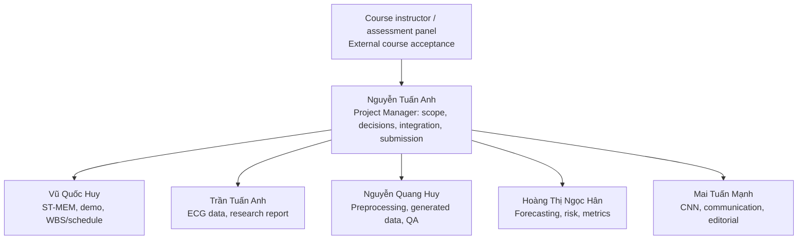

# ECG project: revised deliverable-oriented WBS

**Version:** 11 November 2026 — proposed responsibility plan for team review.  
**Scope:** MIT-BIH ECG research, source-traceable static web demo, recorded-data monitor replay, project reports, verification, and handoff.  
**Excluded:** live ECG acquisition, clinical diagnosis/alarms, patient uploads, production API/hosting, and medical-device validation.

This WBS describes **what must be delivered**. The activity list, dates, dependencies, and hours remain in `ECG_Project_Revised.xml` / `ECG_Project_Revised_Tasks.csv`. A milestone is a review decision, not an extra product. Each leaf package has one proposed lead (R) and one reviewer; the lead coordinates contributors and supplies the evidence. The project manager (PM) owns scope/decision controls and final acceptance, while technical and report sections have specialist leads. These assignments are **proposals for revision and handoff**, not claims about who historically authored a file. Confirm them with the six members before treating them as approved or changing the baseline.

## Project organization

The instructor or assessment panel has external course acceptance authority. The six-person team has one PM and five parallel workstream leads. Each specialist leads assigned deliverables and reports progress or issues to the PM.

| Member | Project position | Primary responsibility |
| --- | --- | --- |
| Nguyễn Tuấn Anh | Project Manager | Business case, charter, change decisions, integration and internal acceptance |
| Vũ Quốc Huy | Technical integration and schedule lead | ST-MEM, static demo, WBS/schedule/cost appendix and release export |
| Trần Tuấn Anh | ECG data and research lead | MIT-BIH interpretation, EDA, research-report assembly and technical evidence |
| Nguyễn Quang Huy | Data preparation and QA lead | Loader, preprocessing, windows, generated data and browser quality checks |
| Hoàng Thị Ngọc Hân | Forecast and risk lead | ARIMA/SARIMA, feature models, metric-source review and risk register |
| Mai Tuấn Mạnh | CNN, communication and editorial lead | CNN/model comparison, communication plan, report merge and replay QA |

## Equal effort allocation for the project report

The project dates remain **22 December 2025 to 6 November 2026** in the schedule. For the course report, the team's total of **222:24 (222.4 hours)** is allocated evenly: **37:04 per member**. This is an **estimated reporting allocation**, not a measured time sheet or a claim about historical authorship. It leaves task owners, dates, deliverables, evidence levels and completion statuses unchanged.

| Member | Estimated contribution to report (h:mm) |
| --- | ---: |
| Nguyễn Tuấn Anh | 37:04 |
| Vũ Quốc Huy | 37:04 |
| Trần Tuấn Anh | 37:04 |
| Nguyễn Quang Huy | 37:04 |
| Hoàng Thị Ngọc Hân | 37:04 |
| Mai Tuấn Mạnh | 37:04 |
| **Whole team** | **222:24** |

The XML and CSV `Work` fields use this equal estimate. Previously recorded `ActualWork` fields and completion evidence are retained as source data; they are not evidence that each person actually logged 37:04. The illustrative labor cost remains VND 11,120,000 at VND 50,000/hour.

## Deliverable-oriented WBS

| WBS | Deliverable / bounded work package | Proposed lead (R) | Reviewer / acceptance evidence |
| --- | --- | --- | --- |
| **1.0** | **Governance and initiation** | — | Charter, plans, logs and decision records |
| 1.1 | Business case, intended users, value measures and options | Nguyễn Tuấn Anh (PM) | Trần Tuấn Anh; reviewed business case |
| 1.2 | Project charter and scope boundary | Nguyễn Tuấn Anh (PM) | Vũ Quốc Huy; charter with deliverables, exclusions and success criteria |
| 1.3 | Deliverable WBS, activity/schedule mapping and cost assumptions | Vũ Quốc Huy | Nguyễn Tuấn Anh; WBS register, XML/CSV cross-check and cost basis |
| 1.4 | Staffing, RACI and communication plan | Mai Tuấn Mạnh | Nguyễn Tuấn Anh; named roles, information recipients and cadence |
| 1.5 | Risk register, owners, triggers and response plan | Hoàng Thị Ngọc Hân | Nguyễn Tuấn Anh; prioritized register with responses and residual risks |
| 1.6 | Quality and acceptance plan | Nguyễn Quang Huy | Mai Tuấn Mạnh; test criteria, owner and independent reviewer for each check |
| 1.7 | Change, issue and gate-decision record | Nguyễn Tuấn Anh (PM) | Vũ Quốc Huy; dated decisions, impact and unresolved items |
| **2.0** | **ECG data foundation** | — | Traceable MIT-BIH data and preparation notebooks |
| 2.1 | MIT-BIH record, lead and beat-label inventory | Trần Tuấn Anh | Nguyễn Quang Huy; source/label inventory and `01_explore_data.ipynb` |
| 2.2 | Data loader and signal-quality checks | Nguyễn Quang Huy | Trần Tuấn Anh; loading/check outputs and documented rejected cases |
| 2.3 | ECG exploration, R-peaks, HR/RR and HRV results | Trần Tuấn Anh | Hoàng Thị Ngọc Hân; `02_EDA.ipynb` and labeled figures |
| 2.4 | Filtering, baseline removal and normalization pipeline | Nguyễn Quang Huy | Trần Tuấn Anh; `03_preprocessing_data.ipynb` and before/after checks |
| 2.5 | Classification windows, Normal/Abnormal labels and split specification | Nguyễn Quang Huy | Mai Tuấn Mạnh; reproducible window/label rules and split counts |
| **3.0** | **Time-series forecast results** | — | Reproducible, sourced ARIMA/SARIMA outputs |
| 3.1 | HR series and stationarity analysis | Hoàng Thị Ngọc Hân | Trần Tuấn Anh; series definition, split and diagnostic plots |
| 3.2 | ARIMA/SARIMA configurations and forecasts | Hoàng Thị Ngọc Hân | Trần Tuấn Anh; notebook, orders, horizon and forecast plots |
| 3.3 | Forecast error table and interpretation | Hoàng Thị Ngọc Hân | Nguyễn Quang Huy; MAE/RMSE linked to the exact run |
| **4.0** | **Classification results** | — | Model artifacts and comparable evaluation records |
| 4.1 | Feature-based RF/ET/XGBoost experiment | Hoàng Thị Ngọc Hân | Mai Tuấn Mạnh; features, label rule, split and metrics |
| 4.2 | 1D CNN experiment | Mai Tuấn Mạnh | Hoàng Thị Ngọc Hân; architecture, window lengths, split and metrics |
| 4.3 | ST-MEM pipeline, saved weights and rerun results | Vũ Quốc Huy | Mai Tuấn Mạnh; code, configuration, saved model and result JSON |
| 4.4 | Model comparison protocol and limitations | Mai Tuấn Mạnh | Trần Tuấn Anh; source map that keeps different label/split rules distinct |
| **5.0** | **Static demo and recorded monitor** | — | Browser-viewable, source-traceable demo assets |
| 5.1 | Generated demo data and local third-party assets | Nguyễn Quang Huy | Vũ Quốc Huy; `demo/data/`, local Plotly and rebuild notes |
| 5.2 | Overview page and analysis charts | Vũ Quốc Huy | Nguyễn Quang Huy; seven sections, chart labels and controls |
| 5.3 | Nine-second ECG replay and rule-based flags | Vũ Quốc Huy | Mai Tuấn Mạnh; past-only HR/RR, completed-window model reveal and replay stop |
| 5.4 | Model result integration and metric source labels | Vũ Quốc Huy | Hoàng Thị Ngọc Hân; displayed values match named notebooks/JSON/PDF |
| 5.5 | Viewing and rebuild instructions | Mai Tuấn Mạnh | Nguyễn Quang Huy; README, dependencies, offline path and limits |
| **6.0** | **Research and management reports** | — | Reviewed report sections and consolidated handoff text |
| 6.1 | Research report: data and ECG methods | Trần Tuấn Anh | Nguyễn Quang Huy; methods, figures and source references |
| 6.2 | Research report: forecast and feature-model results | Hoàng Thị Ngọc Hân | Mai Tuấn Mạnh; experiment settings and result tables |
| 6.3 | Research report: CNN, ST-MEM and model limitations | Mai Tuấn Mạnh | Vũ Quốc Huy; model settings, distinct metrics and limitations |
| 6.4 | Research report assembly and findings review | Trần Tuấn Anh | Nguyễn Tuấn Anh; assembled PDF and recorded review comments |
| 6.5 | Management report: business case, charter and scope decisions | Nguyễn Tuấn Anh (PM) | Trần Tuấn Anh; approved/proposed status clearly labeled |
| 6.6 | Management report: product design, technical results and evidence | Trần Tuấn Anh | Vũ Quốc Huy; artifact-to-claim checks |
| 6.7 | Management report: WBS, schedule, cost and export appendix | Vũ Quốc Huy | Hoàng Thị Ngọc Hân; XML/CSV totals and source references |
| 6.8 | Management report: staffing, RACI and communication | Mai Tuấn Mạnh | Nguyễn Tuấn Anh; roles and channels consistent with this WBS |
| 6.9 | Management report: risk and quality sections | Hoàng Thị Ngọc Hân | Nguyễn Quang Huy; risk/quality plan consistency |
| 6.10 | Management report editorial merge and format check | Mai Tuấn Mạnh | Nguyễn Tuấn Anh; one reviewed version with open comments resolved |
| **7.0** | **Independent verification and handoff** | — | Test records, limitations and acceptance decision |
| 7.1 | Offline browser and chart/control test record | Nguyễn Quang Huy | Mai Tuấn Mạnh; steps, expected/actual results and defect log |
| 7.2 | Replay timing, flags and model-window test record | Mai Tuấn Mạnh | Nguyễn Quang Huy; sampled traces and pass/fail results |
| 7.3 | Independent result-to-source cross-check | Hoàng Thị Ngọc Hân | Trần Tuấn Anh; sampled values, configurations and evidence links |
| 7.4 | ST-MEM discrepancy and product-limit note | Vũ Quốc Huy | Trần Tuấn Anh; PDF/rerun values separately labeled and cause unresolved if unknown |
| 7.5 | Release bundle and MS Project export | Vũ Quốc Huy | Mai Tuấn Mạnh; opening instructions, native export check and file inventory |
| 7.6 | Internal acceptance and course submission record | Nguyễn Tuấn Anh (PM) | Course instructor/assessment panel; signed decision or explicit pending status |

## Responsibility assignment matrix (RAM)

This matrix groups the 40 leaf packages into 16 reviewable workstreams. **R** performs the work; **A** is the single team member accountable for the grouped output. The leaf-package lead above remains responsible for their own package. The evidence column identifies what must be checked before the workstream is handed over.

| WBS | Deliverable | Responsible (R) | Accountable (A) | Evidence / handoff |
| --- | --- | --- | --- | --- |
| 1.1–1.2; 1.7 | Business case, charter and change decisions | Nguyễn Tuấn Anh | Nguyễn Tuấn Anh | Reviewed value case, charter, scope boundary and decision log |
| 1.3; 6.7 | WBS, schedule, cost and export | Vũ Quốc Huy; Hoàng Thị Ngọc Hân | Vũ Quốc Huy | WBS-to-activity map and XML/CSV/cost check |
| 1.4; 6.8 | Staffing, RACI and communications | Mai Tuấn Mạnh | Mai Tuấn Mạnh | Named roles, assignment and communication matrices |
| 1.5; 6.9 | Risk register and responses | Hoàng Thị Ngọc Hân | Hoàng Thị Ngọc Hân | Scored risks, triggers, response owners |
| 1.6; 7.1 | Quality plan and browser QA | Nguyễn Quang Huy | Nguyễn Quang Huy | Criteria, executed checks and defect log |
| 2.1; 2.3 | MIT-BIH inventory and ECG exploration | Trần Tuấn Anh | Trần Tuấn Anh | Source/label inventory and EDA notebook |
| 2.2; 2.4–2.5 | Loading, preprocessing and windows | Nguyễn Quang Huy | Nguyễn Quang Huy | Signal checks, pipeline, label/split rules |
| 3.0 | ARIMA/SARIMA forecasts | Hoàng Thị Ngọc Hân | Hoàng Thị Ngọc Hân | Orders, horizon, plots and MAE/RMSE |
| 4.1 | Feature-based model results | Hoàng Thị Ngọc Hân | Hoàng Thị Ngọc Hân | Features, split, metrics and source map |
| 4.2; 4.4 | CNN and model comparison | Mai Tuấn Mạnh | Mai Tuấn Mạnh | CNN outputs and label-rule limitations |
| 4.3 | ST-MEM pipeline and saved results | Vũ Quốc Huy | Vũ Quốc Huy | Configuration, weights and result JSON |
| 5.0 | Static overview and monitor demo | Vũ Quốc Huy; Nguyễn Quang Huy; Mai Tuấn Mạnh | Vũ Quốc Huy | Offline pages, replay, source-labelled charts |
| 6.1–6.4 | Research report and findings | Trần Tuấn Anh; Hoàng Thị Ngọc Hân; Mai Tuấn Mạnh; Vũ Quốc Huy | Trần Tuấn Anh | Reviewed methods, tables and limitations |
| 6.5–6.6; 6.10 | Management report core sections and editorial merge | Nguyễn Tuấn Anh; Trần Tuấn Anh; Mai Tuấn Mạnh | Nguyễn Tuấn Anh | Charter/technical sections and edited consolidated draft |
| 7.2–7.4 | Independent technical verification | Nguyễn Quang Huy; Mai Tuấn Mạnh; Hoàng Thị Ngọc Hân; Vũ Quốc Huy | Nguyễn Quang Huy | Test log, metric cross-check, discrepancy note |
| 7.5–7.6 | Release package and internal acceptance | Nguyễn Tuấn Anh; Vũ Quốc Huy; Mai Tuấn Mạnh | Nguyễn Tuấn Anh | Bundle/export, internal decision and submission record |

## RACI matrix

This expanded matrix follows the **large lifecycle RACI layout in the Chapter 4 lecture (slide 32)**: rows are grouped by Initiation, Planning, Execution, Monitoring and Control, and Closing. It maps project activities and deliverables to the six team members plus the external course approver. It complements the deliverable-oriented WBS and the 16-row RAM above; a WBS package may appear in more than one phase when its planning and control activities differ.

**R** = performs; **A** = one accountable role; **C** = consulted; **I** = informed; **A/R** = performs and owns. **EXT** = course instructor/assessment panel (individual approver to be confirmed); **NTA** = Nguyễn Tuấn Anh; **VQH** = Vũ Quốc Huy; **TTA** = Trần Tuấn Anh; **NQH** = Nguyễn Quang Huy; **HTNH** = Hoàng Thị Ngọc Hân; **MTM** = Mai Tuấn Mạnh. The EXT assignment for course acceptance is proposed until the actual approver is confirmed.

| Deliverable / activity (WBS) | EXT | NTA | VQH | TTA | NQH | HTNH | MTM |
| --- | --- | --- | --- | --- | --- | --- | --- |
| **Initiation / Khởi tạo** |  |  |  |  |  |  |  |
| 1.1 Define value case and MOV | I | A/R | C | C | I | I | I |
| 1.2 Draft charter and scope boundary | C | A/R | C | C | I | I | I |
| 1.7 Record initial stakeholders and decisions | I | A/R | I | I | I | I | C |
| **Planning / Lập kế hoạch** |  |  |  |  |  |  |  |
| 1.3 Build deliverable WBS and activity map | I | C | A/R | I | I | C | I |
| 1.3 Set schedule and handover gates | I | C | A/R | I | I | C | I |
| 1.3 Estimate cost and planning reserve | I | C | A/R | I | I | R | I |
| 1.4 Define staffing and responsibility matrix | I | C | I | I | C | I | A/R |
| 1.4 Define communication matrix | C | C | I | I | I | I | A/R |
| 1.6 Set quality and acceptance criteria | C | C | I | I | A/R | I | C |
| 1.5 Plan risk responses and reserves | I | C | I | I | C | A/R | I |
| **Execution / Thực hiện** |  |  |  |  |  |  |  |
| 2.1 Inventory MIT-BIH records and labels | I | I | I | A/R | C | I | I |
| 2.2, 2.4 Build loading and preprocessing pipeline | I | I | I | C | A/R | I | I |
| 2.3 Analyze ECG, R-peaks, HR and HRV | I | I | I | A/R | I | C | I |
| 2.5 Prepare windows, labels and data split | I | I | I | C | A/R | I | C |
| 3.1–3.3 Run ARIMA/SARIMA forecasts | I | I | I | C | I | A/R | I |
| 4.1 Evaluate feature-based models | I | I | I | I | I | A/R | C |
| 4.2, 4.4 Evaluate CNN and comparison rules | I | I | I | C | I | C | A/R |
| 4.3 Run ST-MEM and save results | I | I | A/R | I | I | I | C |
| 5.1 Generate demo data and local assets | I | I | C | I | A/R | I | I |
| 5.2–5.4 Build overview and recorded monitor | I | I | A/R | I | R | C | R |
| 5.5 Document viewing and rebuild steps | I | I | C | I | C | I | A/R |
| 6.1–6.4 Assemble research report and findings | I | C | R | A/R | C | R | R |
| **Monitoring and control / Theo dõi và kiểm soát** |  |  |  |  |  |  |  |
| 1.7 Track status, issues and scope changes | I | A/R | C | I | I | I | C |
| 1.5 Review risks and response triggers | I | C | I | I | C | A/R | I |
| 7.1 Test offline browser and chart controls | I | I | C | I | A/R | I | C |
| 7.2 Test replay timing and model-window flags | I | I | C | I | C | I | A/R |
| 7.3 Cross-check metrics against source files | I | I | C | C | I | A/R | I |
| 7.4 Document ST-MEM result discrepancy | I | I | A/R | C | I | I | C |
| **Closing / Kết thúc** |  |  |  |  |  |  |  |
| 6.5–6.9 Complete management report sections | C | A/R | R | R | R | R | R |
| 6.10 Edit report and record lessons learned | I | C | I | C | I | I | A/R |
| 7.5 Package release and export MS Project plan | I | C | A/R | I | I | I | R |
| 7.6 Record internal acceptance and submit | C | A/R | C | I | C | I | I |
| 7.6 Confirm course acceptance | A | R | C | C | C | C | C |

## Boundary and ownership rules

- A work package ends in a reviewable artifact or record. Activities such as “hold a meeting” belong in the schedule under the relevant package; they are not separate WBS deliverables.
- The data/model packages (2.0–4.0) produce technical evidence. The report packages (6.0) communicate that evidence; they do not repeat the experiments.
- Verification (7.0) is independent of implementation. The reviewer records a check rather than approving their own unexecuted test.
- M0–M7 are schedule gates. Their decision records belong to 1.7 or 7.6; a dated gate is not evidence that approval happened.
- Current XML/CSV task names and hours are the existing schedule, not a 1:1 WBS dictionary. Reallocate only unconfirmed work; retain actual author evidence and the report's “proposed” labels. Confirm dates, rates and a new baseline with the team before presenting the revised assignments as approved.

## Crosswalk from the former seven-package summary

| Former package | Revised location |
| --- | --- |
| WP1 Initiation | 1.0 Governance and initiation |
| WP2 Data and methods | 2.0 ECG data foundation |
| WP3 Forecasting | 3.0 Time-series forecast results |
| WP4 Classification | 4.0 Classification results |
| WP5 Research report | 6.1–6.4 Research report packages |
| WP6 Web demo | 5.0 Static demo and recorded monitor |
| WP7 Handoff | 6.5–6.10 Management report and 7.0 Verification and handoff |
