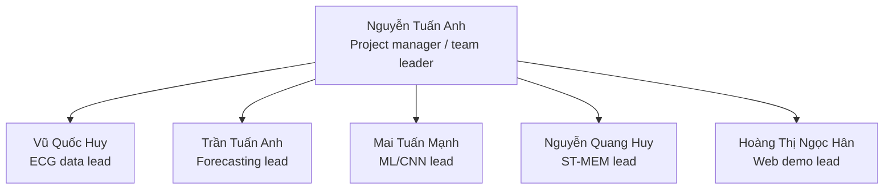

# ECG Time Series Analysis and Static Web Demo — WBS and resource plan

> **Illustrative planning scenario.** Dates, work and costs below are estimates for an academic planning exercise, not timesheets, actual payments, invoices or an approved budget. The six-phase structure and resource sheet adapt the Trakora MPP example. Phase review work is included in the final assigned work package; M1–M6 are zero-duration schedule gates with no additional work or cost.

## 1. Scope and approach

The project delivers a reproducible MIT-BIH ECG analysis, ARIMA/SARIMA forecasting, Normal/Abnormal classification with feature-based ML and 1D CNN, an ST-MEM evaluation, a static view-only web demo, a project report and a handover package. The demo replays recorded excerpts and prepared results. Uploading new ECGs, live patient prediction, diagnosis, backend accounts and production monitoring are outside scope.

The schedule uses six controlled phases. The final work package of each phase includes its review and handoff to the next phase. The three model work packages run in parallel after the data review in Phase 2. QA checks occur within each package and again before acceptance. This is a phase-gated plan with parallel technical tracks; the word *Sprint* from the Trakora example is omitted because this plan does not define Scrum events or a Product Owner.

## 2. Schedule assumptions

- Planned start: **01/10/2026**; planned finish: **09/12/2026**; **50 working days**, Monday–Friday, 08:00–12:00 and 13:00–17:00. The six phases follow the example's 5 + 10 + 10 + 10 + 10 + 5 day rhythm; the dates remain planning estimates.
- Total planned work: **288 person-hours**, exactly **48 hours per member**. Work is distributed by skill and task; equal total hours do not mean every person performs every task.
- Duration is elapsed working days; work is person-hours. A 10-day model package can require 40 hours of work. Increasing Duration from 27 to 50 days does not change the 288 person-hours or the illustrative VND 160,800,000 cost. Phase/project work totals are rollups and must not be assigned a second time.
- Every leaf work package has positive planned work and one accountable owner. The six zero-duration milestones are schedule gates, not extra work packages or resource assignments. They can appear as unassigned 0-hour events in Microsoft Project; the associated review work remains in the preceding assigned package.
- The **illustrative cost scenario is VND 160,800,000**: VND 151,200,000 in valued labor and VND 9,600,000 in planned compute/infrastructure. This is a professional replacement-cost scenario chosen for the exercise, not a record of money the student team paid or received.
- The **cost baseline (BAC) and total planning budget are both VND 160,800,000**. No separate contingency or management reserve has been allocated in this WBS or the MS Project XML. Any future reserve must be estimated and approved through change control before it is added to the budget; no hypothetical reserve is included in planned value (PV).
- Phase reviews are internal team checks, not a claim of external approval.

## 3. WBS by phase

| WBS | Deliverable | Start | Finish | Duration (working days) | Work | Accountable owner | Predecessor(s) |
|---|---|---|---|---:|---:|---|---|
| **1** | **Phase 1: Initiation and integrated planning** | 01/10/2026 | 07/10/2026 | **5 days** | **24 h** | Rollup | — |
| 1.1 | Project charter, scope and acceptance criteria | 01/10/2026 | 02/10/2026 | 2 days | 8 h | Nguyễn Tuấn Anh | — |
| 1.2 | Integrated WBS, schedule and resource plan | 05/10/2026 | 06/10/2026 | 2 days | 10 h | Nguyễn Tuấn Anh | 1.1 |
| 1.3 | Quality, risk and communication baseline with plan review | 07/10/2026 | 07/10/2026 | 1 day | 6 h | Nguyễn Tuấn Anh | 1.2 |
| 1.4 | M1: Integrated project plan gate | 07/10/2026 | 07/10/2026 | 0 days | 0 h | Nguyễn Tuấn Anh | 1.3 |
| **2** | **Phase 2: ECG data foundation** | 08/10/2026 | 21/10/2026 | **10 days** | **48 h** | Rollup | — |
| 2.1 | MIT-BIH inventory and ECG exploration baseline | 08/10/2026 | 13/10/2026 | 4 days | 18 h | Vũ Quốc Huy | M1 |
| 2.2 | Preprocessed ECG and HR/RR dataset with data review | 14/10/2026 | 21/10/2026 | 6 days | 30 h | Vũ Quốc Huy | 2.1 |
| 2.3 | M2: ECG data readiness gate | 21/10/2026 | 21/10/2026 | 0 days | 0 h | Vũ Quốc Huy | 2.2 |
| **3** | **Phase 3: Analysis and model evidence** | 22/10/2026 | 04/11/2026 | **10 days** | **110 h** | Rollup | — |
| 3.1 | ARIMA/SARIMA forecasting results | 22/10/2026 | 02/11/2026 | 8 days | 30 h | Trần Tuấn Anh | M2 |
| 3.2 | ML/CNN classification results | 22/10/2026 | 03/11/2026 | 9 days | 40 h | Mai Tuấn Mạnh | M2 |
| 3.3 | ST-MEM evaluation and combined model review | 22/10/2026 | 04/11/2026 | 10 days | 40 h | Nguyễn Quang Huy | M2 |
| 3.4 | M3: Model evidence review gate | 04/11/2026 | 04/11/2026 | 0 days | 0 h | Nguyễn Quang Huy | 3.1, 3.2, 3.3 |
| **4** | **Phase 4: Static web demo** | 05/11/2026 | 18/11/2026 | **10 days** | **56 h** | Rollup | — |
| 4.1 | Static analysis pages and prepared demo data | 05/11/2026 | 12/11/2026 | 6 days | 32 h | Hoàng Thị Ngọc Hân | M3 |
| 4.2 | ECG replay monitor, integration and demo review | 13/11/2026 | 18/11/2026 | 4 days | 24 h | Hoàng Thị Ngọc Hân | 4.1 |
| 4.3 | M4: Static demo review gate | 18/11/2026 | 18/11/2026 | 0 days | 0 h | Hoàng Thị Ngọc Hân | 4.2 |
| **5** | **Phase 5: Verification and final report** | 19/11/2026 | 02/12/2026 | **10 days** | **38 h** | Rollup | — |
| 5.1 | Verification evidence and issue resolution | 19/11/2026 | 26/11/2026 | 6 days | 24 h | Nguyễn Tuấn Anh | M4 |
| 5.2 | Final project report, user guide and quality review | 27/11/2026 | 02/12/2026 | 4 days | 14 h | Nguyễn Tuấn Anh | 5.1 |
| 5.3 | M5: QA and report review gate | 02/12/2026 | 02/12/2026 | 0 days | 0 h | Nguyễn Tuấn Anh | 5.2 |
| **6** | **Phase 6: Acceptance and handover** | 03/12/2026 | 09/12/2026 | **5 days** | **12 h** | Rollup | — |
| 6.1 | User acceptance and final corrections | 03/12/2026 | 07/12/2026 | 3 days | 8 h | Nguyễn Tuấn Anh | M5 |
| 6.2 | Handover package, retrospective and final acceptance | 08/12/2026 | 09/12/2026 | 2 days | 4 h | Nguyễn Tuấn Anh | 6.1 |
| 6.3 | M6: Final acceptance and handover gate | 09/12/2026 | 09/12/2026 | 0 days | 0 h | Nguyễn Tuấn Anh | 6.2 |

## 4. Work-package completion evidence

| WBS | Evidence required to close the package |
|---|---|
| 1.1 | Charter names the ECG research/demo objective, users, exclusions, deliverables, acceptance criteria and risks; team reviews it. |
| 1.2 | Every work package has one owner, estimated work, duration, dependency and completion evidence; six-person load is checked. |
| 1.3 | Quality checks, key data/model/demo risks and the weekly update channel are recorded; the team reviews the plan and baseline before Phase 2 starts. |
| 2.1 | Record list, lead/sampling details, annotations, basic signal/label plots and source provenance are reproducible. |
| 2.2 | Filtering, R-peak handling, HR/RR derivation, windowing, record-level split and checks against overlapping-window leakage are documented; the data lead records the data-readiness review. |
| 3.1 | Forecast configuration, held-out period, MAE/RMSE and reproducible plots are recorded with the exact model orders used. |
| 3.2 | Feature-based ML and 1D CNN results include record-level split, confusion matrix, F1/AUC and each method's window-label rule; comparisons state limits. |
| 3.3 | Checkpoint provenance, fine-tuning setup, test metrics and difference from the earlier report are explicit; all three model leads review their results together before demo integration. |
| 4.1 | Overview, ECG exploration, preprocessing, forecast and classification pages load prepared data and show source/limitations for metrics. |
| 4.2 | Recorded ECG replay, HR/RR trends and completed-window ST-MEM scores work offline; the integrated demo is reviewed against scope and limitations. |
| 5.1 | Data, model, web and replay checks are logged; major issues are fixed or listed with owner and impact; metrics match their source files. |
| 5.2 | Report explains scope, method, WBS, schedule, roles, risks, evidence and limitations; guide shows how to open and reproduce the demo; QA evidence and report are reviewed together. |
| 6.1 | Acceptance checklist is run on the delivered demo/report; defects are corrected or explicitly accepted with limitations. |
| 6.2 | Source, generated data, report, setup/usage instructions and decision log are handed over; final acceptance and lessons learned are recorded. |

## 5. Team organization and planned work

| Member | Primary role | Planned work |
|---|---|---:|
| Nguyễn Tuấn Anh | Project manager; integration and report | 48 h |
| Vũ Quốc Huy | ECG data and signal processing lead | 48 h |
| Trần Tuấn Anh | HR forecasting lead | 48 h |
| Mai Tuấn Mạnh | ML and CNN classification lead | 48 h |
| Nguyễn Quang Huy | ST-MEM lead | 48 h |
| Hoàng Thị Ngọc Hân | Static web demo and UX lead | 48 h |
| **Total** | | **288 h** |

### Resource Sheet and illustrative rates

| Resource Name | Type | Max. Units | Std. Rate | Ovt. Rate | Work | Cost (VND) |
|---|---|---:|---:|---:|---:|---:|
| Nguyễn Tuấn Anh | Work | 100% | 600,000 VND/h | 900,000 VND/h | 48 h | 28,800,000 |
| Vũ Quốc Huy | Work | 100% | 500,000 VND/h | 750,000 VND/h | 48 h | 24,000,000 |
| Trần Tuấn Anh | Work | 100% | 500,000 VND/h | 750,000 VND/h | 48 h | 24,000,000 |
| Mai Tuấn Mạnh | Work | 100% | 550,000 VND/h | 825,000 VND/h | 48 h | 26,400,000 |
| Nguyễn Quang Huy | Work | 100% | 550,000 VND/h | 825,000 VND/h | 48 h | 26,400,000 |
| Hoàng Thị Ngọc Hân | Work | 100% | 450,000 VND/h | 675,000 VND/h | 48 h | 21,600,000 |
| **Work resource subtotal** | | | | | **288 person-hours** | **151,200,000** |

Work-resource cost equals planned person-hours multiplied by the illustrative standard hourly rate. **Ovt. Rate is an assumed 150% of Std. Rate** for all six people. No overtime work is scheduled. The other VND 9,600,000 is entered as **Fixed Cost on the five work packages that incur it**, so the Resource Sheet contains only the six team members and the overall project budget remains VND 160,800,000.

### Planned work by phase and member

| Phase | Nguyễn Tuấn Anh | Vũ Quốc Huy | Trần Tuấn Anh | Mai Tuấn Mạnh | Nguyễn Quang Huy | Hoàng Thị Ngọc Hân | Total |
|---|---:|---:|---:|---:|---:|---:|---:|
| 1. Initiation and planning | 16 h | 2 h | 2 h | — | — | 4 h | 24 h |
| 2. ECG data foundation | — | 28 h | 9 h | 4 h | 7 h | — | 48 h |
| 3. Analysis and models | — | 8 h | 26 h | 35 h | 35 h | 6 h | 110 h |
| 4. Static web demo | 8 h | 4 h | 2 h | 4 h | 4 h | 34 h | 56 h |
| 5. Verification and report | 20 h | 4 h | 6 h | 4 h | 2 h | 2 h | 38 h |
| 6. Acceptance and handover | 4 h | 2 h | 3 h | 1 h | — | 2 h | 12 h |
| **Total** | **48 h** | **48 h** | **48 h** | **48 h** | **48 h** | **48 h** | **288 h** |

Microsoft Project's Gantt view shows the six phase summaries. Resource Usage groups work by person; this table shows the same assignments rolled up by phase.

### Illustrative cost rollup by phase

| Phase | Valued labor (VND) | Direct cost (VND) | Total (VND) |
|---|---:|---:|---:|
| Phase 1: Initiation and integrated planning | 13,400,000 | — | 13,400,000 |
| Phase 2: ECG data foundation | 24,550,000 | 800,000 | 25,350,000 |
| Phase 3: Analysis and model evidence | 58,200,000 | 7,200,000 | 65,400,000 |
| Phase 4: Static web demo | 27,500,000 | 1,200,000 | 28,700,000 |
| Phase 5: Verification and final report | 21,200,000 | — | 21,200,000 |
| Phase 6: Acceptance and handover | 6,350,000 | 400,000 | 6,750,000 |
| **Total** | **151,200,000** | **9,600,000** | **160,800,000** |

The fixed costs are 800,000 VND on 2.2 (data infrastructure), 2,400,000 VND on 3.2 (CNN compute), 4,800,000 VND on 3.3 (ST-MEM compute), 1,200,000 VND on 4.1 (demo infrastructure), and 400,000 VND on 6.2 (backup and handover). These are planning assumptions and should be replaced if the group obtains actual quotations.

### Work assignment by package

| WBS | Assigned person-hours |
|---|---|
| 1.1 | Nguyễn Tuấn Anh 6 h; Vũ Quốc Huy 2 h |
| 1.2 | Nguyễn Tuấn Anh 6 h; Trần Tuấn Anh 2 h; Hoàng Thị Ngọc Hân 2 h |
| 1.3 | Nguyễn Tuấn Anh 4 h; Hoàng Thị Ngọc Hân 2 h |
| 2.1 | Vũ Quốc Huy 12 h; Nguyễn Quang Huy 3 h; Trần Tuấn Anh 3 h |
| 2.2 | Vũ Quốc Huy 16 h; Trần Tuấn Anh 6 h; Mai Tuấn Mạnh 4 h; Nguyễn Quang Huy 4 h |
| 3.1 | Trần Tuấn Anh 26 h; Vũ Quốc Huy 4 h |
| 3.2 | Mai Tuấn Mạnh 32 h; Vũ Quốc Huy 4 h; Hoàng Thị Ngọc Hân 4 h |
| 3.3 | Nguyễn Quang Huy 35 h; Mai Tuấn Mạnh 3 h; Hoàng Thị Ngọc Hân 2 h |
| 4.1 | Hoàng Thị Ngọc Hân 22 h; Nguyễn Tuấn Anh 4 h; Trần Tuấn Anh 2 h; Mai Tuấn Mạnh 2 h; Nguyễn Quang Huy 2 h |
| 4.2 | Hoàng Thị Ngọc Hân 12 h; Vũ Quốc Huy 4 h; Nguyễn Tuấn Anh 4 h; Mai Tuấn Mạnh 2 h; Nguyễn Quang Huy 2 h |
| 5.1 | Nguyễn Tuấn Anh 8 h; Vũ Quốc Huy 4 h; Trần Tuấn Anh 4 h; Mai Tuấn Mạnh 4 h; Nguyễn Quang Huy 2 h; Hoàng Thị Ngọc Hân 2 h |
| 5.2 | Nguyễn Tuấn Anh 12 h; Trần Tuấn Anh 2 h |
| 6.1 | Nguyễn Tuấn Anh 2 h; Vũ Quốc Huy 2 h; Trần Tuấn Anh 1 h; Mai Tuấn Mạnh 1 h; Hoàng Thị Ngọc Hân 2 h |
| 6.2 | Nguyễn Tuấn Anh 2 h; Trần Tuấn Anh 2 h |

## 6. RACI matrix

**A** = accountable for the deliverable; **R** = performs assigned work; **C** = consulted; **I** = informed. **AR** means the same person is both accountable and responsible. Blank means no standing involvement. Each work package has exactly one A and every planned assignment appears as R or AR. The PM coordinates the baseline and acceptance while technical leads own technical outputs.

| WBS / deliverable | N. Tuấn Anh | V. Quốc Huy | T. Tuấn Anh | M. Tuấn Mạnh | N. Quang Huy | H. Ngọc Hân |
|---|:---:|:---:|:---:|:---:|:---:|:---:|
| 1.1 Project charter, scope and acceptance criteria | AR | R |  |  |  |  |
| 1.2 Integrated WBS, schedule and resource plan | AR |  | R |  |  | R |
| 1.3 Quality, risk and communication baseline with plan review | AR |  |  |  |  | R |
| 2.1 MIT-BIH inventory and ECG exploration baseline | I | AR | R |  | R |  |
| 2.2 Preprocessed ECG and HR/RR dataset with data review | I | AR | R | R | R |  |
| 3.1 ARIMA/SARIMA forecasting results | I | R | AR |  |  |  |
| 3.2 ML/CNN classification results | I | R |  | AR |  | R |
| 3.3 ST-MEM evaluation and combined model review | I |  | C | R | AR | R |
| 4.1 Static analysis pages and prepared demo data | R | C | R | R | R | AR |
| 4.2 ECG replay monitor, integration and demo review | R | R | C | R | R | AR |
| 5.1 Verification evidence and issue resolution | AR | R | R | R | R | R |
| 5.2 Final project report, user guide and quality review | AR | C | R | C | C | C |
| 6.1 User acceptance and final corrections | AR | R | R | R |  | R |
| 6.2 Handover package, retrospective and final acceptance | AR | I | R | I | I | I |

## 7. Control and verification rules

1. Confirm scope in 1.3; validate data and leakage controls in 2.2; review recorded model evidence and limitations in 3.3; test the static demo in 4.2; reconcile report, metrics and issues in 5.2; record acceptance and handover in 6.2.
2. Compare actual progress with this proposed baseline only after the team accepts it. Record actual work and dates from evidence; do not label estimated hours as observed work.
3. A requested scope change is logged, assessed for impact on work, dates, risk and quality, then approved by the team leader and relevant owner before updating the baseline.
4. If a technical branch slips, review its successor phase and available float; never silently move a phase completion date or assign another member beyond 8 working hours per day.
5. Keep the report's four-member author list separate from this six-person project-management team. The prior report is technical evidence, not the roster for this plan.

## 8. Source mapping

- Trakora.mpp: six phase summaries, leaf work packages, phase-end checks and finish-to-start links. M1–M6 are zero-duration phase gates following the assigned review work packages; tasks, roles, work and dates are ECG-specific.
- IT project-management lectures: deliverable-oriented WBS and 100% rule; distinct work/duration; phase review criteria; dependency logic; RAM/RACI with one A; quality and risk controls. See `IT_Project_Management_Knowledge_Synthesis.md` sections 4–5, 7–8 and 10–13.
- ECG repository: `README.md`, `plan.md`, notebooks, `demo/` and `Final_Report_TS-3.pdf` for scope, existing artifacts and known model/demo limitations.
